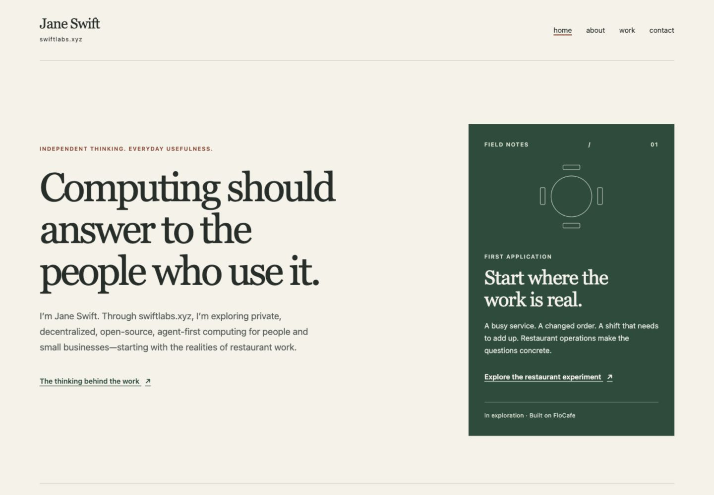
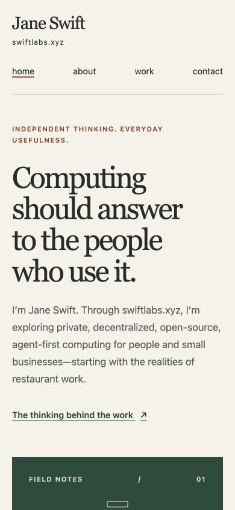

# Verification and handoff — September 20, 2026

## Result

Implemented the accepted overhaul across all five pages, shared layout/site data, stylesheet and manifest. The error page is excluded from the sitemap through its collection setting. README links the planning/evidence packet. Existing routes, email, domain and LICENSE are preserved. At the original verification handoff, no commits, pushes or publication had occurred. The later user-approved baseline commits are recorded below; no push or publication is included.

## Executed checks

| Check | Actual result |
| --- | --- |
| `PATH=/private/tmp/node-v20.20.2-darwin-arm64/bin:$PATH npm run build` | Pass, Eleventy 3.1.2; four copied assets and six generated files. Repeated after source formatting. |
| `npm run dev -- --port=8080` with the same PATH | Pass after user-authorized retry; local preview at http://localhost:8080/. Initial sandbox bind failed and the first escalation was declined. The user then requested a retry, which was approved. |
| `python3 docs/planning/site-overhaul/verify-static.py` | Pass. Five HTML pages: one H1/main each, unique IDs, valid local destinations/anchors, descriptions and canonical URLs. Person JSON parses. Manifest/domain align. Sitemap contains exactly four content routes. |
| `git diff --check` | Pass. |
| Desktop rendering | Inspected all five pages at 1440×1000 in the Codex in-app browser. Saved viewport screenshots. Checked lower homepage/About content and restaurant evidence layout. |
| Mobile rendering | Inspected all five pages at 390×844. Restaurant questions/evidence and homepage field note/principles additionally inspected below the fold. |
| 320px reflow | All five pages had scrollWidth equal to clientWidth (320); no main descendants exceeded the right viewport boundary. Inspected homepage field note/principles at this width. |
| Keyboard | First Tab reveals a visible skip link. Enter then Tab reaches the first main-content link, bypassing header navigation. Full Work page Tab sequence reaches skip link, brand, four nav links, page CTA and both footer links in order. Focus screenshot saved. |
| Focus and contrast | Explicit visible outline verified visually. Ten text color/background combinations computed using relative luminance: 5.36:1–12.64:1. Details in static-checks.json. |
| Motion | Loaded stylesheet inspected in browser: no animation or transition declarations; reduced-motion rule sets automatic scrolling. No animated media or public executable script added. |
| Public assets / implementation inventory | Generated markup contains only local stylesheet/manifest assets and inert Person JSON-LD. Public copy/metadata checked for implementation-product inventory. External font requests removed. Live preview adds only the local Eleventy reload script. |
| Browser console | Queried captured warning/error logs after page inspection; no entries returned. |
| Goal prompt | goal-prompt.md is 2,222 Unicode characters including newlines, below 4,000. No native Goal was created or replaced. |

Raw results: [static-checks.json](static-checks.json), [browser-checks.json](browser-checks.json). Static verification script is included for reproducibility; it uses Python’s standard library and operates on generated output after a build.

## Limits, not passes

- Browser zoom keyboard shortcuts produced no observable zoom change in the in-app browser. Actual 200% browser zoom remains unverified; viewport reflow is separate evidence.
- The browser controls expose no reduced-motion emulation. The stylesheet’s no-motion behavior was inspected, but toggling the OS preference was not performed.
- Network request tracing was unavailable in the supported browser scope. Asset/stylesheet/script inspection found no external loads; this is not a captured network trace.
- No physical mobile devices, screen-reader session or cross-browser matrix was exercised. Mobile evidence is viewport testing.
- FloCafe remote fork capability and public availability remain unverified; the site intentionally makes no stronger claim. Application tests were outside the site task.
- A full-page screenshot attempt produced stitching artifacts. Evidence files were replaced with viewport captures; no stitched image is offered as layout evidence.

These limits prevent describing the work as a comprehensive accessibility certification. No known rendering or static validation failure remains from the checks performed.

## Screenshots

Screenshots live in `screenshots/`: Home, About, Work, Contact and 404 at desktop/mobile widths, plus keyboard and below-fold views. Temporary browser viewport overrides were reset. The local preview was left available for review.

## Committed baseline

The working tree was clean before implementation. The original handoff left all overhaul changes unstaged and uncommitted. The user subsequently approved the three proposed baseline commits on `codex/swiftlabs-site-overhaul`:

1. `bbf72d8` — `docs(plan): specify Jane-led site overhaul`: spec.md, source-check.md and goal-prompt.md.
2. `13b5cd0` — `feat(site): establish editorial baseline for swiftlabs.xyz`: README and all nine changed source files. No dependency/lockfile changes or generated-output edits.
3. The commit containing this record — `docs(qa): record baseline verification and screenshots`: verification.md, verify-static.py, static-checks.json, browser-checks.json and screenshots.

This third commit is the complete comparison point for subsequent theme experiments. Preserve the accepted copy and routes when comparing themes. The verification results above describe the original implementation checks; committing them does not imply those checks were rerun. Staged diff hygiene was checked for each baseline commit.

Pushes and publication remain unauthorized. For a later runtime session, use an available Node 20 installation; the temporary `/private/tmp` runtime is not a durable project dependency.
